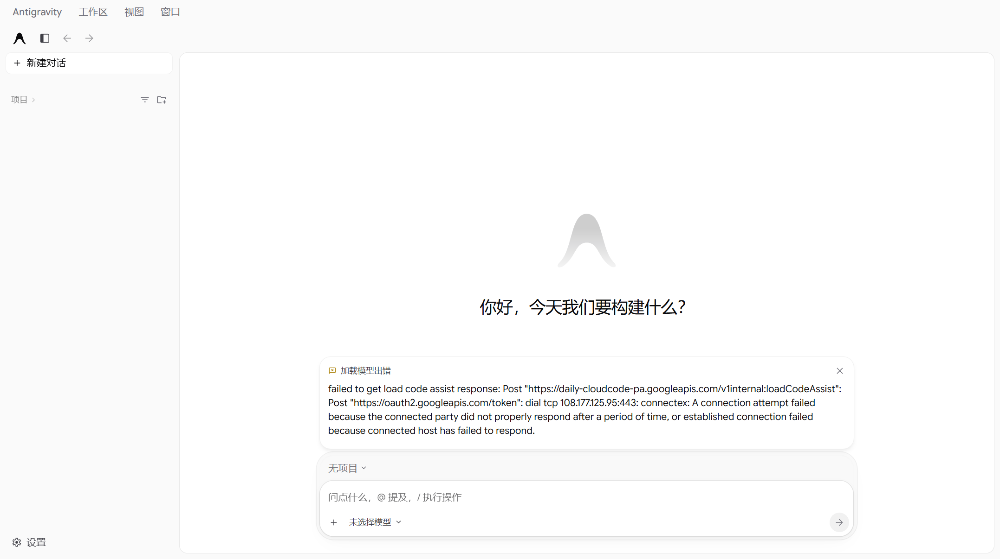
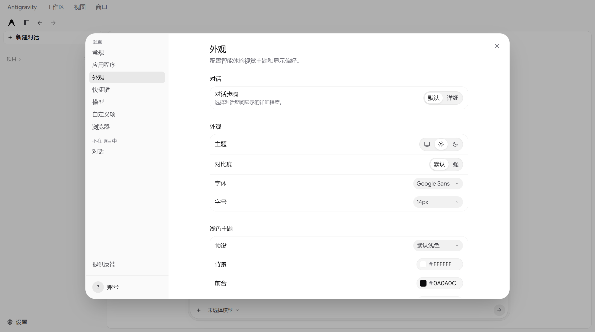
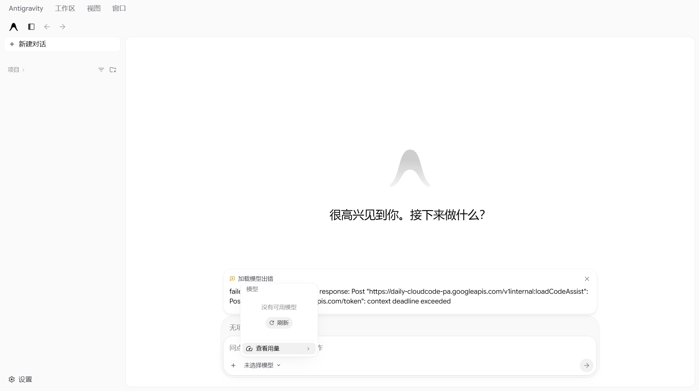

# Antigravity Simplified Chinese Localization

An **unofficial** Chinese (Simplified) UI patch for [Antigravity](https://antigravity.google), Google's AI code editor (Electron + Go).

Antigravity 2.34.0 renders its UI from a local HTTPS server run by `language_server.exe` (Go). There is no official language pack, and the app ignores `?hl=` / `Accept-Language`. Instead of touching the Go binary, this project patches the Electron main process inside `app.asar` (a few KB): a loader is injected after `require("electron")`, which executes a translation script in every page. A dictionary plus regular-expression templates replace English strings with Chinese, and a `MutationObserver` re-translates after React re-renders.

> This repository ships **no** Antigravity binaries or source code — only injection scripts, dictionaries and an asar reader/writer. Install the official client first.



| Settings · Appearance | Model menu |
| --- | --- |
|  |  |

## Features

- Translates UI text, input placeholders, `aria-label` / `title` tooltips, application menu and tray menu
- ~2,500 entries (machine translated, then hand-reviewed), plus regex templates for dynamic sentences (counts, shortcuts, relative time)
- Dictionary lives in `%APPDATA%` and is hot-reloadable with `Ctrl+R` — no repacking needed
- Untranslated strings are logged to `missing.log` for easy follow-up
- Installer auto-detects the installation directory and backs up the original `app.asar`

## Requirements

- Windows 10/11
- [Antigravity](https://antigravity.google) 2.x (tested with 2.34.0)
- [Node.js](https://nodejs.org) 18+ (stdlib only, no npm dependencies)

## Install

1. Clone or download this repository
2. Double-click **`install.cmd`** — it closes Antigravity, backs up `app.asar`, patches it and relaunches the app

Or from a terminal:

```bat
node src\install.js --app "C:\Users\<you>\AppData\Local\Programs\antigravity" --force --launch
```

`--app` can be omitted; the script checks environment variables, common install folders and the registry.

## Uninstall

Double-click **`uninstall.cmd`**, or:

```bat
node src\uninstall.js --force
```

The original archive is kept at `<install dir>\resources\app.asar.zh-backup` and removed on uninstall.

## After an Antigravity update

Updates overwrite `app.asar`, so the patch is lost (the backup file survives). **Run `install.cmd` again after every update.**

> If a new release changes the structure of `dist/main.js`, the installer fails with an error instead of corrupting the app.

## Customizing the dictionary (hot reload)

1. Edit `dict/dict.json` or `dict/manual.json` (`manual.json` has priority)
2. Run `node src\sync.js`
3. Press `Ctrl+R` in the Antigravity window

Runtime files live in `%APPDATA%\Antigravity\zh-hans\`:

```
dict.json       merged dictionary
inject.js       in-page translator
templates.json  regex templates
native.json     Electron native menu strings
missing.log     English strings the page translator could not match
```

### Dictionary format

```json
{
  "New Conversation": "新建对话",
  "Add context": "添加上下文"
}
```

- Keys must match the English UI byte-for-byte (including leading/trailing spaces)
- Keep placeholders in translations: `{name}`, `%s`, `%d`
- Brand names, keyboard shortcuts and font names stay in English

### Template format (`templates.json`)

```json
[
  ["^Select (.+), current: (.+)$", "选择 $1，当前：$2"],
  ["^Shortcut (.+) for (.+)$", "快捷键 $1：$2"]
]
```

Captured groups are translated with the dictionary before substitution.

## How it works

```
Antigravity.exe (Electron)
└─ resources/app.asar
   └─ dist/main.js          ← patched: loader inserted after require("electron")
      └─ loader.js          main process side
         ├─ app.on('web-contents-created') → dom-ready → executeJavaScript(inject)
         ├─ wraps Menu / Tray to translate native menus
         └─ captures __ZHMISS__ logs → missing.log
```

- Pages are served with `lang="en"`; the injector switches it to `zh-CN`
- `inject.js` uses a `MutationObserver`, skips `script/style/code/pre`, `contenteditable` and `translate="no"`
- asar packing is handled by `tools/asar-tool.js` (supports unpacked entries, writes no integrity field)

## Known limitations

- Raw Google API errors (e.g. `failed to get load code assist response: ...`) and skill/plugin descriptions are content data and are left as-is
- A few dynamically composed sentences may be missed; they are logged to `missing.log`
- Windows only (the same injection approach should work elsewhere, but it is untested)
- Verified against 2.34.0 only

## Disclaimer

Not affiliated with Google. This project only modifies UI resources of a locally installed client and distributes no Google software or code. Check that this is allowed by your local law and by Antigravity's terms of service; use at your own risk.

## License

[MIT](LICENSE). Dictionary and translation PRs are welcome.