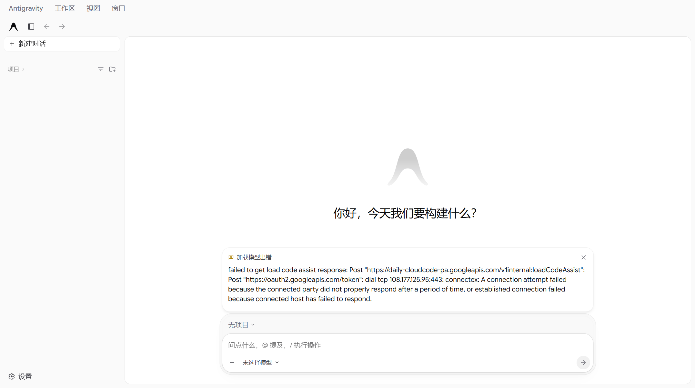
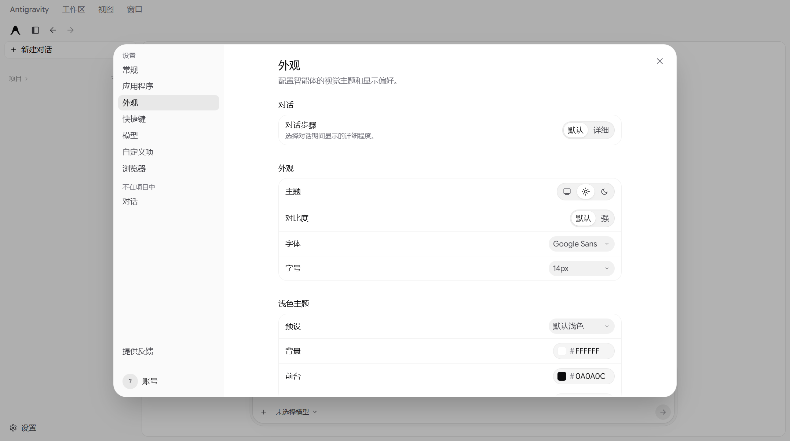
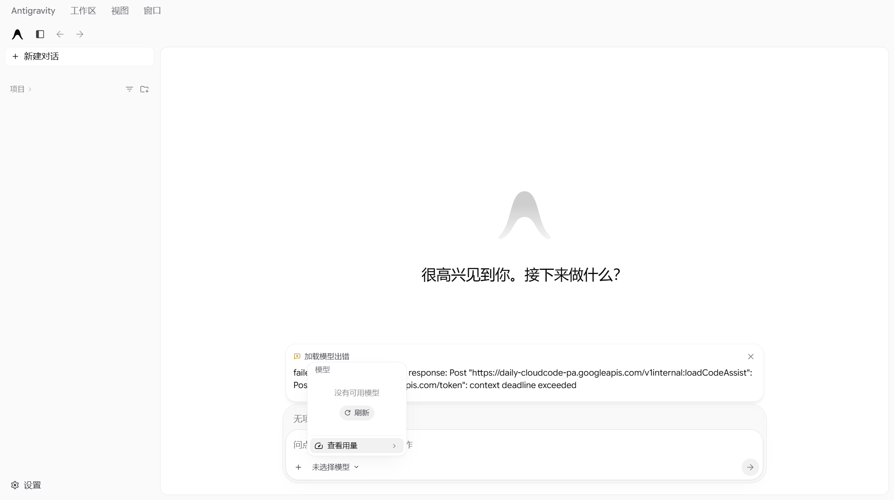

# Antigravity 简体中文汉化

给 [Antigravity](https://antigravity.google)（Google 的 AI 代码编辑器，Electron + Go）做的**非官方简体中文界面补丁**。

Antigravity 2.34.0 的界面由 `language_server.exe`（Go）通过本地 HTTPS 提供，官方没有语言包、也不读 `?hl=` / `Accept-Language`。本项目不改 `language_server.exe`，只给 Electron 主进程的 `app.asar` 打一个几 KB 的小补丁：启动时把翻译脚本注入每个页面，用「词典 + 正则模板」把英文文案实时替换成中文，React 重渲染后会自动复译。

> 仓库里**不包含** Antigravity 的任何二进制或源码，只包含注入脚本、词典和 asar 读写工具。使用前请自行安装官方客户端。



| 设置 · 外观 | 模型菜单 |
| --- | --- |
|  |  |

## 特性

- 覆盖界面文案、输入框 placeholder、`aria-label` / `title` 提示、应用菜单与托盘菜单
- 约 2500 条词条（机器翻译 + 人工校对），支持正则模板处理「计数 / 快捷键 / 时间」等动态句子
- 词典是**运行时文件**，改完按 `Ctrl+R` 就能生效，不用重新打包
- 自动记录没翻到的英文到 `missing.log`，方便持续补词
- 安装/卸载脚本自动定位安装目录、自动备份原版 `app.asar`

## 环境要求

- Windows 10/11
- 已安装 [Antigravity](https://antigravity.google) 2.x（测试版本 2.34.0）
- [Node.js](https://nodejs.org) 18+（仅用标准库，无 npm 依赖）

## 安装

1. 下载或克隆本仓库
2. 双击 **`install.cmd`**（会关闭正在运行的 Antigravity、备份原版 asar、打补丁并重新启动）

或者用命令行：

```bat
node src\install.js --app "C:\Users\<you>\AppData\Local\Programs\antigravity" --force --launch
```

`--app` 可省略，脚本会依次尝试环境变量、常见安装目录和注册表。

## 卸载

双击 **`uninstall.cmd`**，或：

```bat
node src\uninstall.js --force
```

原版备份在 `<安装目录>\resources\app.asar.zh-backup`，卸载时会还原并删除。

## Antigravity 更新后

每次更新会覆盖 `app.asar`，汉化随之失效（备份文件不会被更新删除）。**更新后重新运行一次 `install.cmd` 即可。**

> 如果新版本的 `dist/main.js` 结构变化导致锚点找不到，脚本会报错退出，不会破坏原文件。

## 修改词典（热更新）

1. 编辑 `dict/dict.json` 或 `dict/manual.json`（`manual.json` 优先级最高，用来覆盖或补充）
2. 运行 `node src\sync.js`
3. 在 Antigravity 窗口按 `Ctrl+R`

运行时的词典在 `%APPDATA%\Antigravity\zh-hans\`：

```
dict.json       合并后的词典
inject.js       页面内翻译器
templates.json  正则模板
native.json     Electron 原生菜单词条
missing.log     页面上没匹配到的英文（自动记录）
```

### 词典格式

```json
{
  "New Conversation": "新建对话",
  "Add context": "添加上下文"
}
```

- key 必须与界面英文**逐字节一致**（首尾空格也算）
- 中文里保留占位符：`{name}`、`%s`、`%d`
- 品牌名（Antigravity、Google、Gemini、GitHub 等）、快捷键、字体名不翻译

### 模板格式（`templates.json`）

```json
[
  ["^Select (.+), current: (.+)$", "选择 $1，当前：$2"],
  ["^Shortcut (.+) for (.+)$", "快捷键 $1：$2"]
]
```

`$1`、`$2` 会先按词典翻译再填入。

## 工作原理

```
Antigravity.exe (Electron)
└─ resources/app.asar
   └─ dist/main.js          ← 补丁：require("electron") 之后插入 loader
      └─ loader.js          主进程侧
         ├─ app.on('web-contents-created') → dom-ready → executeJavaScript(inject)
         ├─ 包装 Menu / Tray，翻译原生菜单
         └─ 捕获 __ZHMISS__ 日志 → missing.log
```

- `lang="en"` 的页面会在注入后改成 `zh-CN`
- 页面内的 `inject.js` 用 `MutationObserver` 监听 DOM 变化，跳过 `script/style/code/pre`、`contenteditable` 和 `translate="no"`
- asar 读写全部由 `tools/asar-tool.js` 完成，兼容 Electron 的 asar 格式（含 unpacked 条目），重打包不写 integrity 字段

## 已知限制

- Google API 网络错误原文（如 `failed to get load code assist response: ...`）、插件/skill 的英文描述属于**内容数据**，不翻译
- 极少数运行时拼接的动态句子可能漏翻，`missing.log` 会记录，补进词典即可
- 仅支持 Windows；其他平台理论上可用同样的注入思路，但没有测试
- 只针对 2.34.0 验证过；新版本锚点或页面结构变化可能需要更新脚本

## 免责声明

本项目与 Google 无关，是非官方社区汉化。仅修改本机已安装客户端的界面资源，不分发任何 Google 的软件或代码。使用前请确认这符合你所在地区的法律与 Antigravity 的服务条款；因修改客户端造成的任何问题由使用者自行承担。

## 许可证

[MIT](LICENSE)。词典与译文欢迎 PR 补充。